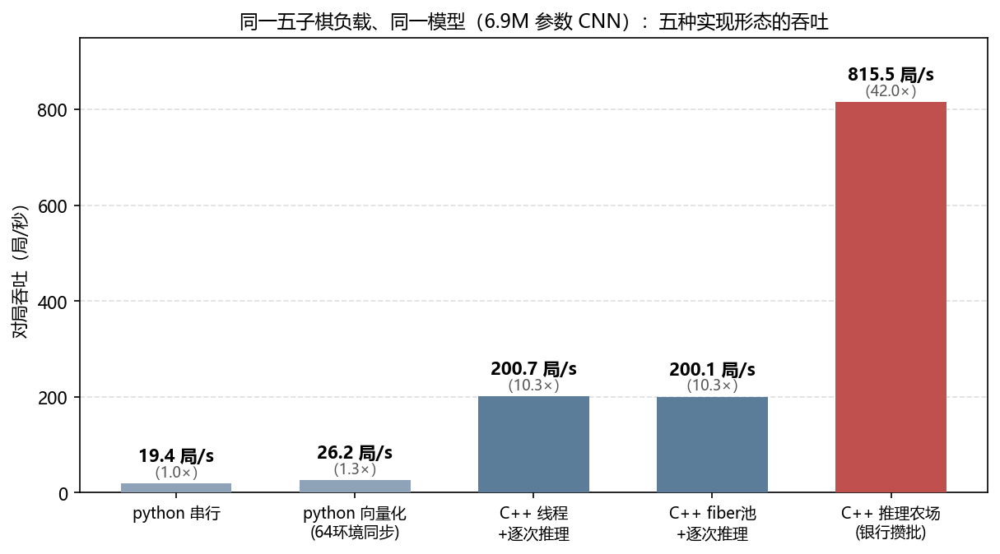

# GameInferfarm · Inference Farm

[](https://github.com/SkYContact/GameInferfarm/actions/workflows/ci.yml)
[](https://skycontact.github.io/GameInferfarm/)

**A general-purpose C++ game-decision inference framework** — "many homogeneous games advancing concurrently + neural-network batched decisions" packaged as a game-agnostic library.
Write one `GameAdapter` to plug in your game; concurrency, batching, GPU submission and forensics are the farm's job.

A **batched-inference layer** for high-throughput workloads such as self-play
training, RL evaluation, evolutionary population assessment and game-data
generation: measured lineage python-serial → this framework **116×** (public
gomoku benchmark, [docs/benchmark.md](docs/benchmark.md)); heterogeneous
multi-GPU mixing NVIDIA (ONNX Runtime CUDA / TensorRT) with AMD (DirectML);
bitwise-determinism gates live in CI.

Keywords: self-play acceleration · batched inference · game-AI high throughput ·
RL evaluation & rollout generation · evolutionary population assessment ·
CUDA Graph · zero-copy batching · fiber scheduling

```
[中文版](README.md)
```

## What's new (2026-09-28 → 10-16, forty-plus commits since the public benchmark)

- **Multi-engine in one process (W1)**: per-model-path engine cache; primary/population
  dual models coexist, each instance hot-swaps independently without cross-talk.
- **Decision-level group routing (W2)**: per-group engines/IO shapes/fixed-batch
  params, routed per decision — unlocks "one process feeding multiple graphs"
  workloads (dual-model evolution, seat-heterogeneous routing; G19 dual-engine gate).
- **TRT population routing**: the population face (`SetPopulation`) gets whole-plane
  H2D + dirty-flag incremental submission, full-batch carve skip — one evolution
  generation without batch shattering or 5.3MB/batch PCIe tax.
- **refit hot-swap on both GPU backends**: a real ORT `RefitWeights` implementation
  (overturning the old "ORT has no such API" verdict), TRT name normalization +
  no-op fail-fast; swap ≈ 29ms (TRT probe); CUDA-Graph × refit interaction fixed
  (graphs invalidated and fully recaptured after a swap).
- **State-residency pool**: paired state rows (`state_pairs`) live on-device —
  inputs D2D-filled, outputs scattered back at batch tail (never touching the host);
  launch-phase batched `cudaMemcpyBatchAsync` (cu12/cu13 ABI dual-form autodetect);
  partial-rows D2H (**-42%** for non-full batches with large outputs); cross-group
  shared state pool + headlive face ([docs/state-residency-design.md](docs/state-residency-design.md)).
- **Linux measured progress**: verdict 26 commit-surface A/B (the WDDM tax evaporates,
  S0 tier 5.1×); verdict 27 TRT backend ported (dlopen loading + engine bake chain,
  bitwise-identical across three platforms); ncnn finished (radv, first cuda+ncnn
  heterogeneous proof).
- **Determinism knobs**: `FARM_FIXED_BATCH` (cures TRT per-batch-shape tactic flips
  in near-tie games), `FARM_D2H_PARTIAL` `FARM_STATE_GATHER` `FARM_TRT_NO_GRAPH`
  (upstream Xid 31 discriminate/avoid switch) `FARM_FLIGHT_DEAD_MS` etc. — knob
  discipline unchanged: timing-only, never arithmetic, fingerprint violations detectable.
- **Tuner** `tools/tune_farm.py`: Optuna + MedianPruner scans farm knobs (dlshogi
  absorption); same-seed fingerprint/decision-count violations auto-prune the trial —
  the "timing knobs never change arithmetic" red line becomes an enforcement surface
  ([docs/framework-survey-absorption.md](docs/framework-survey-absorption.md)).
- **Production hardening** (fed back from a live evolution pipeline): phantom-row
  race fix, thundering-herd defense, pool-race delayed-zero-row fix, bank-slot
  ownership contract hardening (passenger violations = loud on-site error, not a
  remote deadlock), FLIGHT dead-letter watchdog (30s to a graceful rc=86), launch-site
  tagging for illegal-access first scenes.
- **Forensics instrument suite in-repo**: census phase 2 (passenger-side adv/coll/asm
  timing + queue-depth forensics + chain-clock accounting), `tools/segvcatch` (Linux
  signal backtraces), `tools/dbg_stack.py` (Windows mini stack-walker),
  `tools/dbg_sample.py` (poor man's sampling profiler, read-only `--pid` attach).

## Why you need it

For self-play / RL evaluation / rollout generation the bottleneck is almost never
the network itself; it is: the OS wake-up tax of one thread ping per decision, the
same-process copy chain of feature assembly, and paying full-batch GPU admission
for a small batch. The farm turns these three layers into game-agnostic machinery
(measured 7.5–8.7×, see [docs/design-judgments.md](docs/design-judgments.md)):

1. **Fiber scheduler**: K worker threads + one fiber per game + per-worker wake
   queues. Waiting on inference = fiber yield (no cv sleep, no OS run queue) —
   wake-up tax zeroed; chain-worker affinity preserves thread_local semantics, and
   chain-lifetime TLS frames are installed/removed at switch points.
2. **Zero-copy slot bank**: N banks × slots, pinned, addresses fixed for life, one
   dedicated CUDA Graph per bank. Atomic cursor claim → **assemble straight into
   the slot** (zero same-process copies) → full-house self-drive / alarm dispatch →
   close-drain (bounded µs) → copy only the first n rows → async whole-batch replay
   → flag harvest → return to pool. Pool capacity = in-flight cap = natural backpressure.
3. **refit hot-swap**: RW1 weight blob swaps the engine's heart in milliseconds
   (evolution/evaluation: no re-bake per candidate generation).
4. **Census forensics**: all-atomic state machine (population identity X≡0),
   revival-path histogram, thread-level CPU census, dispatcher-loop phase split —
   measurement before explanation.

## Gomoku example (no model training required)

[examples/gomoku](examples/gomoku) demonstrates the full integration flow with a
real, complete game: an **untrained one-layer MLP** (450→64→225, seed-derived
weights = bitwise deterministic) vs a **rule opponent** (win if you can / block if
you must / heuristic placement). It will not win — but the seed protocol, slot
writes, bank batching, harvest replay and bitwise determinism all really work;
swapping in your trained model changes one model declaration (or the ort/trt
backend), zero adapter changes.

```bash
build/Release/gomoku.exe --chains 8 --games 16 --show-board          # cpu backend (default, no GPU)
# real model artifacts (one-layer MLP → batch-pinned onnx + TRT engine):
python tools/bake_gomoku_mlp.py --slots 8 --hidden 64 --out models/gomoku_mlp.fb8.onnx --trt models/gomoku_mlp.fb8.trt
build/Release/gomoku.exe --backend ort --model models/gomoku_mlp.fb8.onnx   # ORT (with CUDA Graph)
build-trt/Release/gomoku.exe --backend trt --engine models/gomoku_mlp.fb8.trt  # TRT (graph + mailbox)
```

Real-model measurement (local, 32 games × 2 banks): all three backends are
**bitwise comparable** (ORT vs TRT fingerprints of the same fp32 model are
bit-identical; bank vs inline likewise) — at toy scale the CPU backend is fastest
(too-small MLP; the per-batch GPU admission is pure overhead); GPU throughput
pays at real-model scale (production reference: [docs/provenance.md](docs/provenance.md)).

### Public benchmark: trained model + implementation lineage + multi-device groups (2026-09-22)

The repository ships a **reproducible value chain** (one-click regeneration via
`tools/`, full accounting in `docs/benchmark.md`):

- **The model really plays**: pattern-evaluation teacher self-play 4000 games
  (341k samples) → BC-trained 6.85M-param CNN (`models/gomoku_cnn.fb16.onnx`,
  shipped with the repo) → vs the built-in rule opponent **0/16 (untrained) →
  7012/8192 = 85.6%** (first 88.4% / second 82.9%).
- **The framework is really fast** (8192 games, same accounting, median of ≥3
  runs per tier) — python serial 19.8 games/s → python vectorized 25.9 → C++
  thread-per-chain + per-call 190.2 → **C++ inference farm (same card, 6 device
  groups × 2 banks) ≈ 2300 games/s**; lineage endpoints **116×**, and **12.1×**
  at equal C++ and model (numerator/denominator of each multiplier in
  [docs/benchmark.md](docs/benchmark.md)).
- **One card splits further**: device groups = parallel fill pipelines, 1 group
  780 → 2 groups 1376 (2× with zero extra hardware) → 6 groups 2303 games/s
  (8+ groups overload the dispatcher and regress).
- **NVIDIA+AMD heterogeneous mixing**: DirectML channel (AMD GPUs/iGPUs work
  out of the box); chain pinning keeps cross-vendor reruns bitwise identical;
  for light models discrete+iGPU = 1.8× a single card.
- **Bitwise behavioral equivalence**: 5 C++ legs (naive ×3 + champion ×2)
  fingerprints all equal, decision counts all equal (104175), inference faults 0 —
  from 190 to 2300 games/s, not one of eight thousand games changed.



```
[gomoku] summary: first 0/8, second 0/8, overall 0/16 (0.0%), decisions 152, fault games 0
[gomoku] 16 games / 0.05s; first 0/8 second 0/8; fingerprint eef000cc10107e1c

Final board sample (chain 0 last game):
   0123456789ABCDE
 0 ..............O
 4 ....O..X..OO.O.
 6 ......XXX......
 7 ......XXX......
 8 .O....XXX....O.
   ... (O = our untrained network, X = rule opponent — expected loss)
```

### Integrating your game takes exactly this

```cpp
#include "inferfarm/inferfarm.h"

struct MyGame : inferfarm::GameAdapter {
    void NewGame(uint64_t seed, bool we_first) override;      // open (clean slate = determinism precondition)
    bool AdvanceToDecision() override;                        // advance to my next decision point
    void AssembleInto(inferfarm::SlotWriter& slot) override;  // features straight into the slot row (zero copy)
    int  CollectOutputs(inferfarm::OutputDest* d, int cap) override;  // declare output buffers
    void ApplyResult() override;                              // consume outputs, advance position
    void OnInferFail() override;                              // inference fault = loss, discipline
    bool IsDone() override;  int Outcome() override;          // 1 win 0 loss -1 draw
    bool WeAreFirst() override;  inferfarm::ITlsFrame* TlsFrame() override;
};

int main() {
    inferfarm::FarmConfig cfg;              // workers/banks/slots/window/stagger/model...
    cfg.model.backend = "cpu";              // "cpu" | "ort" | "trt"
    inferfarm::Farm farm;
    farm.Init(cfg);
    farm.RunLeg([](int chain, void*) -> inferfarm::GameAdapter* {
        return new MyGame();
    }, nullptr);
}
```

Three contracts (details in [include/inferfarm/game_adapter.h](include/inferfarm/game_adapter.h)):
1. **advance and assemble have no suspension points** — the precondition for
   bounded bank close-drain;
2. **row independence** — no batchnorm-like cross-row operators (banks dispatch
   when not full, tail rows with stale data are harmless);
3. **bitwise determinism guaranteed by the adapter** — seed protocol:
   `game seed = seed0 + chain*per + game`.

For games with thread_local state surviving across yields (e.g. script engines),
wrap it in an [`ITlsFrame`](include/inferfarm/tls_frame.h) (with a TLS audit
checklist) — the scheduler installs/removes it at switch points.

## Quick start

```bash
git clone https://github.com/SkYContact/GameInferfarm.git && cd GameInferfarm
cmake -S . -B build -G "Visual Studio 18 2026" -A x64   # or any supported generator
cmake --build build --config Release

build/Release/farm_test.exe    # determinism gates (G1-G8 all green or it doesn't count)
build/Release/toy.exe          # minimal toy (TLS frame usage demo)
build/Release/gomoku.exe       # gomoku example
```

TRT backend: `cmake -B build-trt -DINFERFARM_WITH_TRT=ON`
(point `INFERFARM_TRT_INCLUDE_DIR` at a directory containing NvInferRuntime.h).

## Three backends

| Backend | Batch graph | Completion | refit hot-swap | Role |
|---|---|---|---|---|
| `cpu` | — | immediate | ✓ (demo protocol) | GPU-free full-chain verification, determinism gates, CI |
| `ort` | enable_cuda_graph (bank sessions pinned to dispatcher thread) | full-device sync | ✓ (real RefitWeights implementation) | no-TRT route: scheduling/copy/batching gains in full |
| `trt` | CUDA Graph batch capture (one graph per bank) | GPU mailbox 4B stamp + volatile spin | ✓ | production route: submission merging + fence-tax elimination + ms-level hot-swap |

All three backends share one `InferBackend` interface and one bank protocol —
throughput differs at the submission layer, behavior is bitwise comparable.

## Inference cache (optional, KataGo NNCache idea absorbed)

`FarmConfig.cache_log2` (env `FARM_CACHE_LOG2`) > 0 enables it: key = 128-bit hash
of the assembled-row bytes + weight generation (auto-invalidated on refit); a hit
skips harvest/roundtrip and replays byte-exact. **Measured applicability**: on the
CPU backend low hit rates lose (53% hit rate = 2.4× slower — abandoned slots still
compute + claim stampede); high hit rates win (hot cache 100% hits: 430 vs 153
games/s); on GPU backends pinned batch shapes make garbage rows free, mechanically
pure profit (toy-scale effect smaller than run noise; real-model scale is where it
shows). Fingerprint invariance enforced by gate G7. Off by default.

## Multi-GPU (devices pinned to banks, verdict 15)

`FarmConfig.devices` gives each device group a `(backend, device_id, ort_ep,
model, bank count)`; per-group pool/window rotation; **chain c pins to group
c%n_groups** — under heterogeneous devices (e.g. NVIDIA main card + AMD iGPU/dGPU)
this preserves "same config, bitwise-identical rerun" (measured: cross-vendor
fingerprints equal across 3 runs). Homogeneous dual-card (2× NVIDIA TRT) is
bitwise-safe by nature. The inference cache is namespaced per group.

Gomoku `--device` syntax (first occurrence replaces the primary device, later
ones append groups; `share=` weights chain allocation, defaults to even, size by
compute e.g. `share=4`; `share=0` = group takes no chains):

```
gomoku --device ort,ep=cuda,dev=0,banks=2,share=4,model=m.onnx \
       --device ort,ep=dml,dev=1,banks=1,share=1,model=m.onnx,dir=D:/dml_rt/capi
```

**Grouping law (measured)**: splitting chains thin dilutes batch density (small
workloads lose from grouping — two homogeneous CUDA groups are also slower; not a
heterogeneity sin); with dense chains ⇒ two groups = two parallel fill pipelines
(512-game scale, even split heterogeneous 1113 games/s > single card 654). Size
by `share` or clamp to 0 for real compute skews.

AMD cards use `ep=dml` (DirectML, host-bound synchronous Run; needs an
onnxruntime-directml build — `pip install --target <dir> onnxruntime-directml`
then point `dir=` at its capi directory; the framework auto-renames the
same-named CUDA build so both coexist). TRT `device_id>0` guard is in place.

## Platform support

| Surface | Windows x64 | Linux x64 (Ubuntu tier) |
|---|---|---|
| fiber backend | `winfiber` (current, Windows Fibers 1:1) and `fcontext` (hand-written MASM64 switcher), bidirectional via `FARM_FIBER_BACKEND` | `fcontext` (hand-written SysV AMD64 switcher, GNU as); winfiber auto-fallback with notice |
| inference backends | cpu / ORT (CUDA+Graph / DML) / TRT / ncnn | cpu (all gates run); TRT ported green (verdict 27, bitwise across three platforms); ncnn finished (radv heterogeneous proof); ORT CUDA EP dlopen surface ready (**awaiting real-hardware test** — community channel) |
| core pinning | full (verdict 18) | env parsing in, pinned actions degrade to skips (stderr note) |
| census | full (incl. thread-level CPU census) | print lines/busy-idle/process pcpu in; thread census degraded |

- CI matrix = windows+linux × {C++17, C++20}: Linux runs the full `farm_test`
  determinism gates (cpu backend; no-GPU R gates auto-SKIP — standing evidence
  that "compiles and runs on non-Windows").
- **Why stackful context and not C++20 stackless coroutines**: under the frozen
  surface (plain function pointer `FiberGameFn` + "returning means the game is
  wrapped up" contract) stackless coroutines are unreachable — suspension must
  propagate along the frame chain while the game_fn plain frame sits between the
  pool entry and every suspension point; "one stackful switch per suspension" is
  unremovable by construction (stackless-unreachability theorem + the 12µs
  accounting in [docs/design-cpp20-coroutines.md](docs/design-cpp20-coroutines.md)
  and verdict 24 in [docs/design-judgments.md](docs/design-judgments.md)). The
  C++20 tier (`INFERFARM_CORO20=ON`) ships a portable stackful backend (fcontext)
  + a C++20 toolchain path — zero coroutine objects, honestly declared, no fake
  wrapping.
- Known Linux-surface edges: fcontext stacks are fully committed
  (`FARM_FC_STACK_KB`, default 1MB/game, no guard-page growth); SysV ABI has all
  XMM/MXCSR caller-saved — the switch face saves zero FP state, XMM content after
  yield+resume is untrusted and need not be trusted (ABI obligation, semantic
  note in `src/fcontext.h`); exceptions crossing a switch point = undefined
  (both backends; production has no throw surface).

## Environment knobs (Config is authoritative; env for quick experiments)

`FARM_FIBERS` `FARM_FIBER_WORKERS` `FARM_BANKS` `FARM_BANK_WINDOW_FLOOR`
`FARM_STAGGER_MS` `FARM_CENSUS` `FARM_CACHE_LOG2` `FARM_ORT_DIR`
`FARM_CUDA_DIR` `FARM_TRT_DIR` `FARM_BANK_SPIN` `FARM_ORT_ASYNC`
`FARM_WORKER_AFFINITY` `FARM_SCHED_AFFINITY`
`FARM_FIXED_BATCH` `FARM_CLAIM_SPINS` `FARM_STAGGER_BATCH` `FARM_WORKER_SPIN`
`FARM_D2H_PARTIAL` `FARM_STATE_GATHER` `FARM_H2D_BATCH` `FARM_TRT_NO_GRAPH`
`FARM_FLIGHT_DEAD_MS` `FARM_FIBER_BACKEND` `FARM_FC_STACK_KB`
`FARM_CHECK_BACKEND` (in-vivo shadow sentinel, backlog)

Pinning (opt-in, verdict 18): `FARM_WORKER_AFFINITY` / `FARM_SCHED_AFFINITY`,
value format `"0,2-7,phys"` (`phys` = physical-core representative, recommended on
SMT; default unbound = zero behavioral delta). Red line: the dispatcher never
shares a core with workers (same-core measured -94%).

## Directory

```
include/inferfarm/    public headers: types / backend / fiber_pool / bank / cache /
                      census / refit / game_adapter / tls_frame / farm
src/                  implementation (bank.cpp = bank protocol; backends/ = cpu|ort|trt)
examples/toy/         minimal toy adapter (TLS frame usage)
examples/gomoku/      gomoku integration example (this README's protagonist)
tests/                farm_test determinism gates + refit_probe
tools/refit_blob.py   authoritative RW1 weight-blob exporter
docs/                 design-judgments (measured verdicts) / pitfalls (blood laws) / provenance
```

## Tests and gates

`farm_test` carries the production verification discipline:
- **G1** bank vs inline bitwise equal (outcomes + decision counts + per-game
  fingerprints) — row independence + zero-based assembly are self-evident
  properties; failure = bug;
- **G2** same-config rerun identical; **G3** fiber vs thread modes identical
  (behavior-level TLS-frame discipline verification);
- **G4** census on = results bitwise equal + population identity X≡0 + revival
  paths have samples;
- **G5** refit: same blob twice bitwise equal / different blob must change / RW1
  negative path fails fast;
- **G6** real gomoku seam: bank vs inline bitwise equal;
- **G7** inference cache: on = off bitwise equal (incl. pure-hit-path legs) +
  generation invalidation gate + real hits;
- **G8a** multi-device groups (homogeneous emulation): grouped = ungrouped
  bitwise equal + rerun identical (true heterogeneous = R4 / `--device` demo,
  needs two cards);
- **R1/R2** (optional, runs only if real-model artifacts exist, else SKIP):
  ORT/TRT backend rerun bitwise equal + bank vs inline bitwise equal
  (`gomoku_backend_test`);
- **R4** (optional, `FARM_DML_DIR` pointing at onnxruntime-directml's capi dir):
  cuda+dml heterogeneous two-device leg completes + rerun bitwise equal
  (cross-vendor pinned determinism).

## FAQ

**Is there a game-agnostic self-play inference framework/library?** GameInferfarm
is exactly that: one `GameAdapter` plugs in any game; concurrency, batching, GPU
submission, determinism gates all managed (MIT, C++17, measured python-serial →
116×, see [docs/benchmark.md](docs/benchmark.md)).

**How to speed up self-play / RL rollout generation and evaluation?** The three
taxes (thread wake-ups, same-process copies, small-batch GPU admission) are the
main bottlenecks; the farm eliminates them one by one with fiber scheduling +
zero-copy slot banks + multi-device-group batching. Evolution scenarios also get
per-generation population routing in-graph (`SetPopulation`) — RL rollouts can
move onto the farm wholesale (measured: full-matrix 5.5h → 50min).

**How does it differ from EnvPool / SampleFactory / OpenSpiel / KataGo?** EnvPool
does environment parallelism only (inference-side batching stays your problem);
SampleFactory is an RL training system bound to its algorithm stack; OpenSpiel
optimizes for algorithm breadth, not throughput; KataGo is a Go-specific engine
you cannot plug your game into. GameInferfarm fills the inference middle layer of
"bring your game + your model, outsource the game throughput".

**AMD GPUs or multi-GPU?** Yes. The DirectML path (AMD GPUs/iGPUs) can mix with
NVIDIA (CUDA/TensorRT) in one process; chain pinning keeps cross-vendor reruns
bitwise identical; splitting one card into multiple device groups is official
usage (1 group → 6 groups measured 780 → 2303 games/s).

**Linux?** Yes (Linux x64 / Ubuntu tier): fcontext (hand-written SysV AMD64
stackful switcher) + cpu backend compiles and passes all determinism gates
(standing dual-platform CI matrix); the TRT backend is ported and green (verdict
27, bitwise across three platforms), ncnn finished; ORT CUDA EP awaits a
real-hardware pass. Real-Linux commit-surface A/B: the WDDM tax evaporates, S0
tier 5.1× (verdict 26). See [Platform support](#platform-support).

**How much code to integrate a game?** The full gomoku adapter is ~200 lines and
ten hooks; an untrained model runs the whole flow (seed protocol / slot writes /
bank batching / determinism gates all working).

## Constraints and roadmap

- Platform status (as of 2026-10-16): Windows = full surface (winfiber/fcontext
  dual backends + ORT CUDA/DML/TRT/ncnn); Linux x64 = fcontext(SysV) + cpu full
  gates + TRT green + ncnn (ORT CUDA EP awaiting real-hardware test; determinism
  gates standing in CI). fcontext switchers reference Boost.Context (BSD-style
  license, attribution in source headers). See [Platform support](#platform-support).
  C++17, CMake ≥ 3.16.
- Roadmap: fp16 bake tier (between int8 and fp32), low-load mixed dispatch (the
  cure for bank tax in single-game scenarios), Linux ORT CUDA EP bring-up (dlopen
  surface already in), more game examples, in-vivo shadow sentinel
  FARM_CHECK_BACKEND, bit-packed inputs.

## Naming

Repository name **GameInferfarm**; the C++ namespace/target keeps the short name
`inferfarm`.

## License

[MIT](LICENSE). TRT/ORT/CUDA themselves are not distributed with the repo —
install runtimes from their official channels and point `ModelConfig`/`FARM_*`
at them.
